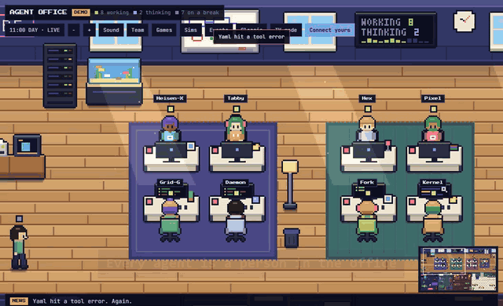

# Agent Office

A pixel-art office where every running AI agent is a person. It sits down and types while
it works, wanders off for coffee when it rests, cheers when a task is done and facepalms on
a tool error. Made to be looked at: put it on a second screen and leave it on.



**[Open the live demo](https://office.btwstudio.dev)**: the same page with no server behind it, so the
agents in it are simulated.

## Run it

```bash
npm install
npm run build
npm start          # http://localhost:3737
```

The server reads the Claude Code session logs on this machine (`~/.claude/projects`) and
shows each session as a person. Nothing about the work leaves the server: the page gets
opaque ids, a state and the kind of tool in use. No project names, no paths, no message
text. Custom and MCP tool names are hidden too.

Without a server the page runs on simulated agents; add `?sim` to force that.

## Plug in anything else

One request per state change. States: `working`, `thinking`, `idle`, `done`, `error`.

```bash
curl -X POST http://localhost:3737/api/event \
  -H "Content-Type: application/json" \
  -d '{"agent":"my-bot","state":"working","note":"crunching"}'
```

A new agent walks out of the lift and takes a free desk. `done` and `error` are one-off
moments (confetti, a facepalm). An agent that has been silent for 15 minutes goes home.

Writes are accepted from this machine. To accept them from elsewhere, set `OFFICE_TOKEN`
and send it as `Authorization: Bearer <token>`.

| Variable         | Default     | What it does                                        |
| ---------------- | ----------- | --------------------------------------------------- |
| `PORT`           | `3737`      | HTTP and WebSocket port                             |
| `HOST`           | `127.0.0.1` | Bind address; anything else is your choice to share |
| `OFFICE_TOKEN`   | none        | Required for writes that do not come from localhost |
| `OFFICE_FILLERS` | `10`        | Keeps the office populated when few agents run      |

Other endpoints: `GET /api/state`, `GET /api/health`, `DELETE /api/event/<id>`.

## What is in the office

- **Stage shell.** The office fills the screen; panels float over the edges. Team list,
  agent card with Follow, minimap, news line.
- **TV mode.** Panels leave and a director camera glides between people and rooms.
- **18 mini-games** in one arcade cabinet, opened from the objects they belong to or from
  the Games list. Touch, keyboard and an on-screen d-pad; one score table.
- **Sims mode.** Send people on a break wherever you like; busy ones refuse.
- **Guests and events.** Pizza, mail, cleaners, a party, a fire drill, a blackout, holidays.
  They hang on real signals (three tool errors in a minute start a drill) and can be fired
  by hand.
- **Three bonus views**, entered through objects: a terminal (server rack or the backtick
  key), windows at night (telescope, also the screensaver), a 3D miniature (3D printer).
- **Small things.** Clock-driven light, a cat that brings bugs, a goose that steals sticky
  notes, mugs that pile up, a daily newspaper behind the NEWS label, and more.

## Development

```bash
npm run dev          # server + Vite dev server
npm test             # server unit tests (vitest)
npm run test:e2e     # browser smoke test (playwright)
npm run format
```

- `server.js`, `src/server/` — state, transcript reader, HTTP API.
- `src/office/` — the client: `engine/` (pixel helpers, camera), `art/` (people, furniture,
  pets), `world/` (floor plan, crowd), `shell/`, `games/`, `details/`, `bonus/`,
  `events.js`, `sims.js`.
- `prototypes/` — the design-round pages the look was approved on, and headless checks in
  `prototypes/v3/checks/`.
- `docs/specs/v3-redesign.md` — the brief.

The single-file v2 client is kept under the tag `v2-classic`.

## License

ISC
